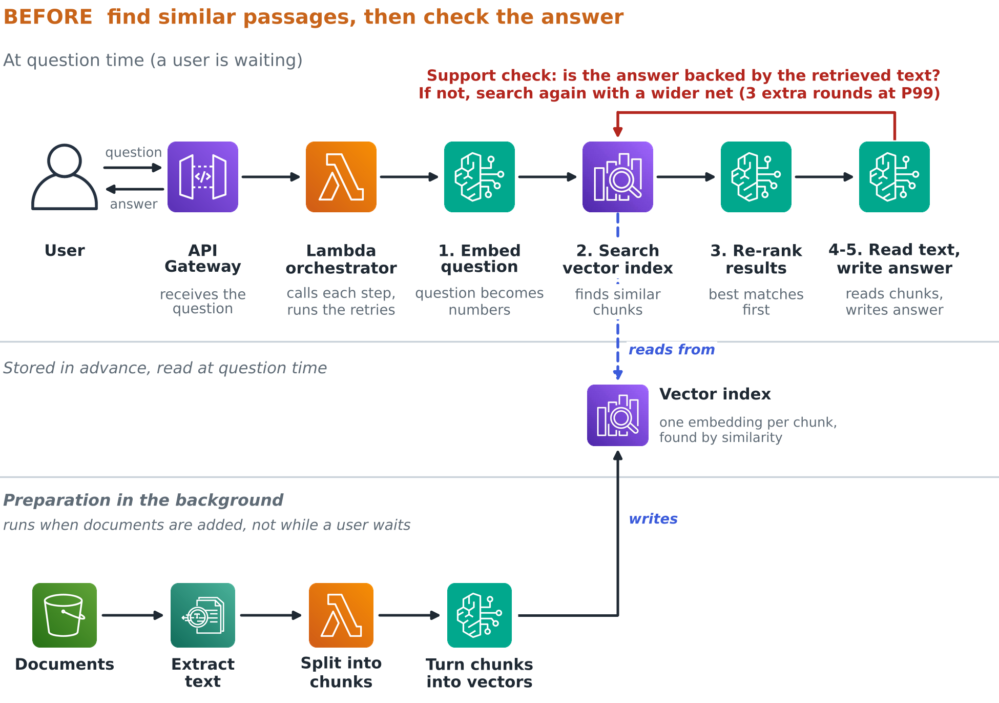
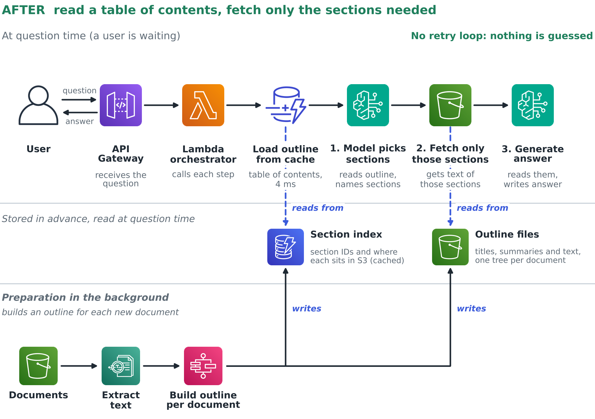
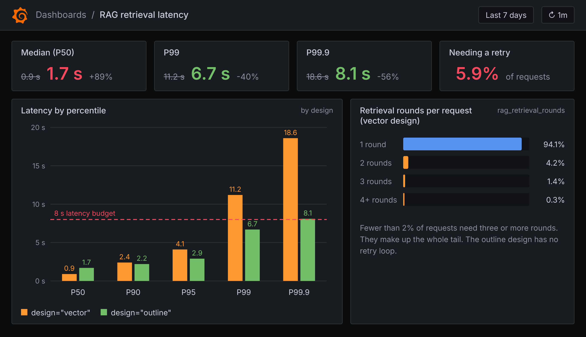
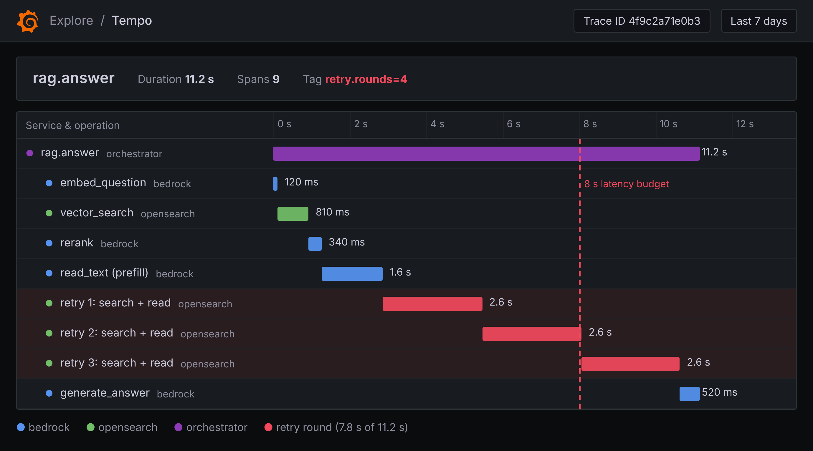
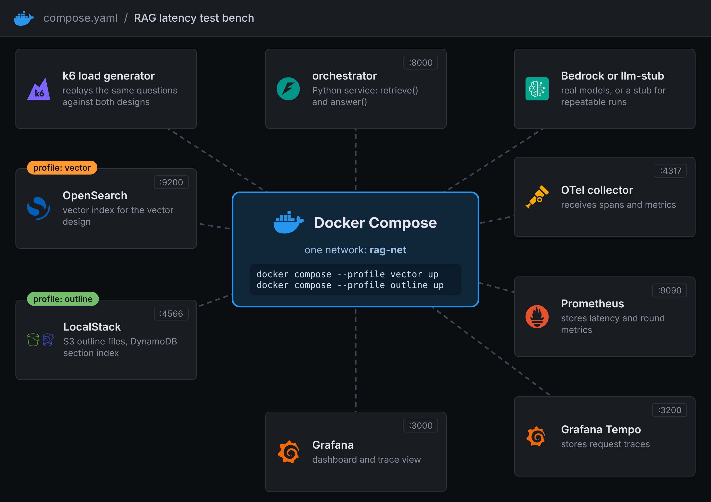
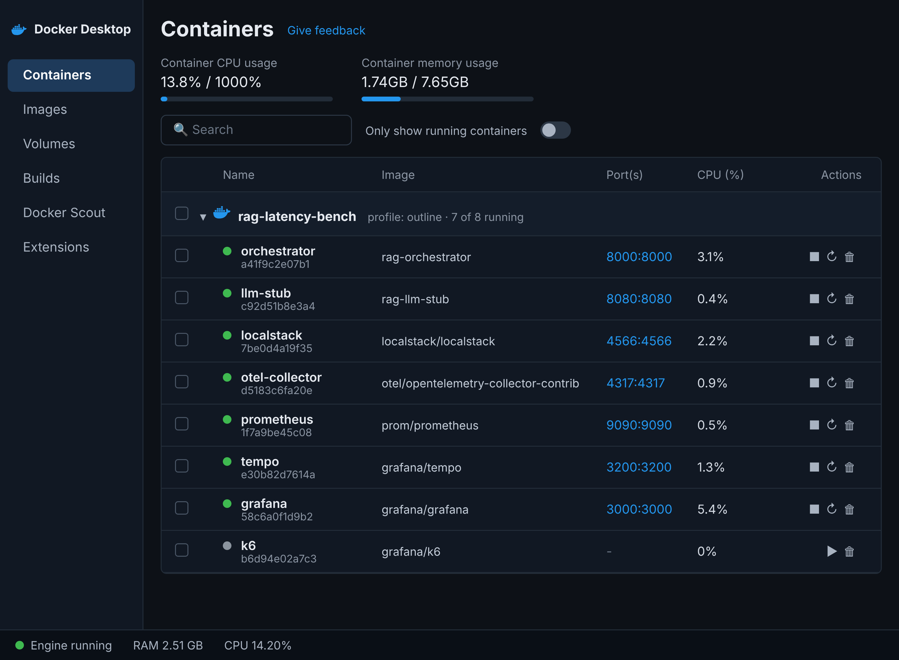

# RAG latency bench: vector search vs an outline

This is a small test bench for one question. When a RAG system has a slow tail, is the vector database the cause?

I ran into this in my own work. Most requests were fast, but the slowest 1% took far too long. Tuning the usual settings barely helped. Replacing vector search with a prebuilt document outline made the typical request slower and the slowest requests much faster. This repo lets you try that comparison yourself.

> **Please read this first.** The models here are simulated. A stub service sleeps for a configurable time and answers by simple rules, so every run is repeatable and needs no cloud account. The numbers you get will show the *shape* of the trade-off, not the numbers from my study. Change the step times in `.env` to match your own system.

## The two designs

**Design A: vector search.** The question is embedded, a vector database (OpenSearch) finds similar passages, a re-ranker sorts them, and a model writes the answer. A support check then asks whether the passages really answer the question. If not, the search widens (`k = 20 + rounds * 10`) and everything runs again. That retry loop is where the slow tail comes from.



**Design B: outline.** Each document is turned into a tree of sections with titles and short summaries. The tree files sit in S3, the section index sits in DynamoDB (both run in LocalStack here), and a small cache keeps hot outlines in memory. At question time the model reads the outline, picks the sections, and the system fetches them. There is no embedding, no vector search and no retry loop.



## Run it

You need Docker with Compose and about 6 GB of free memory.

```bash
make up              # both designs plus Grafana, Prometheus, Tempo and the collector
make load-vector     # 5 minutes of load against the vector design
make load-outline    # 5 minutes of load against the outline design
make down            # stop everything and remove volumes
```

Then open Grafana at http://localhost:3000 and look for the dashboard called **RAG latency: vector vs outline**. No login is needed.

Useful settings (copy `.env.example` to `.env`):

| Variable | Default | What it does |
| --- | --- | --- |
| `RATE` | `5` | Requests per second sent by k6 |
| `DURATION` | `5m` | How long each load run lasts |
| `EMBED_MS`, `RERANK_MS` | `40`, `80` | Median simulated time for those steps |
| `SELECT_MS`, `GENERATE_MS` | `800`, `600` | Median simulated time for the two model calls |

## What you should see

The orchestrator exports latency histograms and a retrieval-rounds histogram. Grafana turns them into the percentile view below. The outline design should start slower at the median and finish faster in the tail.



Every pipeline step is also a trace span, so a slow request in Grafana Tempo shows its retries as extra bars.



The stack is one Docker Compose project on one network. The two designs have their own profiles, so only the store you need is started.



And this is roughly how the containers look in Docker Desktop once everything is up.



The four images above are illustrative mock-ups made for my article. Your own dashboard and containers will look similar, but the numbers will be yours.

## How the synthetic data works

The corpus is 40 contract-style documents with eight sections each. Most questions ask about a fact that one section states directly. About 10% ask about a fact whose section uses different wording, while a separate section only says "see the terms in Section 6". Word-based search ranks the pointer section first and the real answer far down the list, so the vector design has to widen its search. That is the case that creates retries. Change the share with `hard_ratio` in `bench/corpus.py`.

## What this bench does not claim

- It does not reproduce my numbers. The models, the embedding and the re-ranker are simulated.
- The vector design searches the whole corpus, while the outline design is scoped to one document. That matches a "ask about this document" use case, but it favours the outline.
- It does not test Amazon S3 Vectors or DynamoDB vector search.
- A time-to-live cache stands in for DAX, because LocalStack does not provide DAX.
- Vector search is often the better choice. One study of SEC filings found that vector retrieval won 68% of comparisons. Use this bench to measure your own case.

## Project layout

```
bench/            the two retrieval designs, pipeline, API, metrics
llm_stub/         the simulated model service
observability/    Grafana, Prometheus, Tempo and collector config
k6/               the load script
tests/            unit tests (no Docker needed)
```

Run the tests with `make install && make test`. CI runs lint, tests, config checks, a Dockerfile lint and a smoke test that starts the outline stack.

## Author

Jubin Soni. I write about distributed systems, data engineering and AI infrastructure. [LinkedIn](https://linkedin.com/in/jubinsoni)
